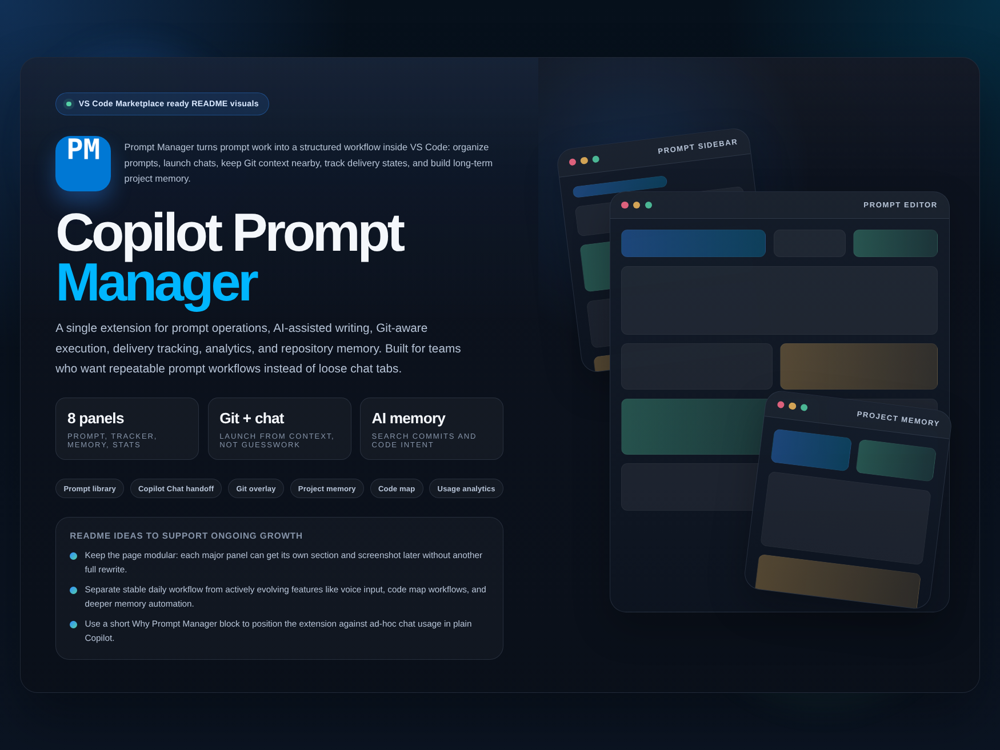
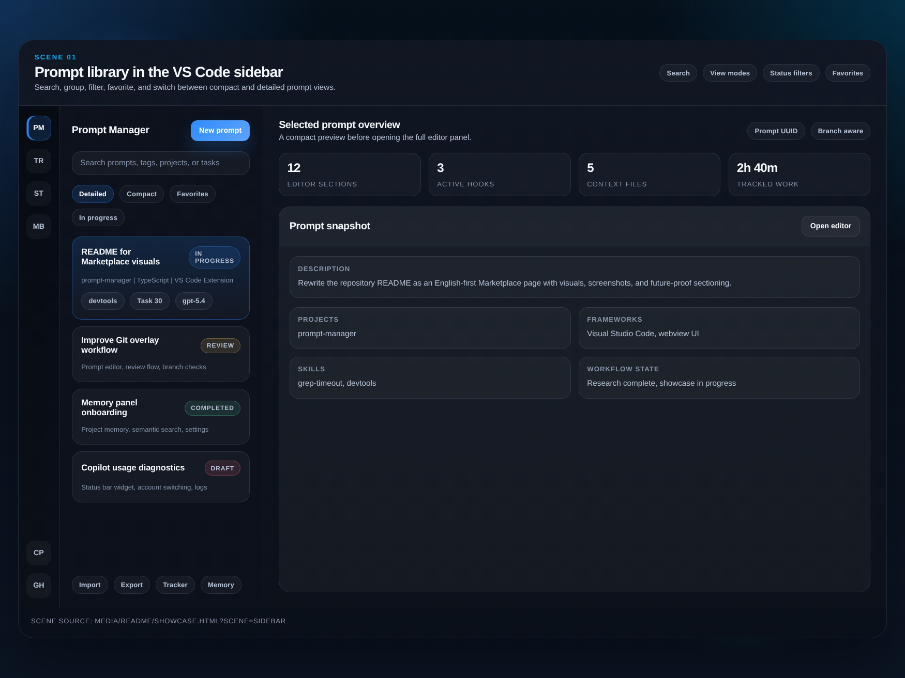
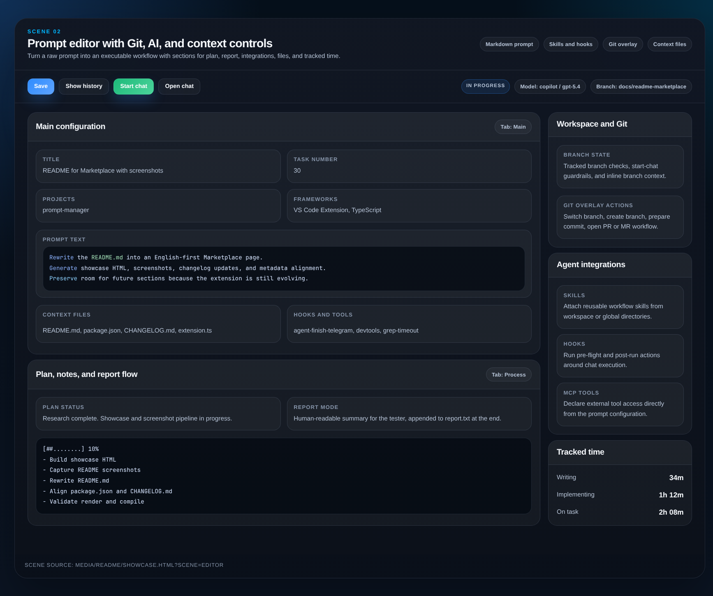
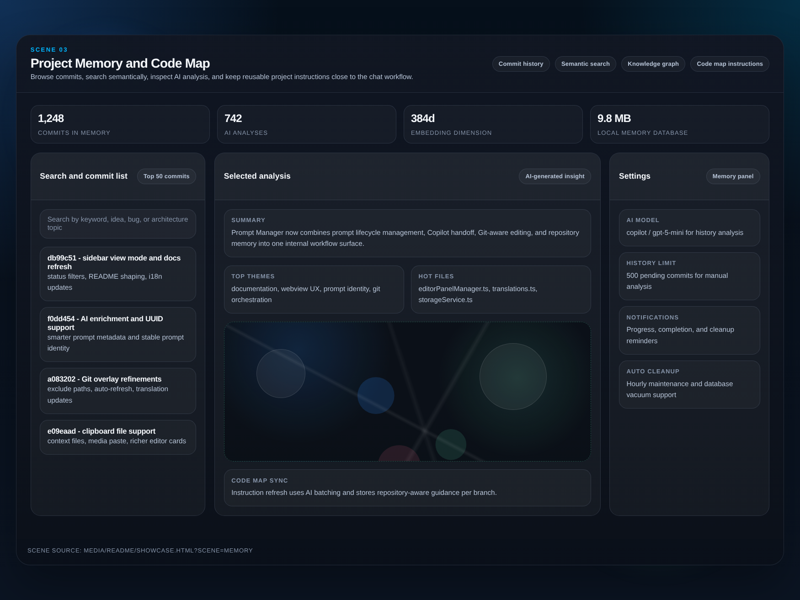

# Prompt Manager

<p align="center">
  
</p>

<p align="center">
  <strong>Prompt workflows that stay attached to your code.</strong><br>
  Run AI chat from saved context, keep Git and delivery state nearby, and build project memory inside VS Code.<br>
  <strong>Промпты, Git-контекст, отчёты и память проекта в одном рабочем процессе прямо в VS Code.</strong>
</p>

<p align="center">
  <a href="https://marketplace.visualstudio.com/items?itemName=alek-fiend.copilot-prompt-manager">Marketplace</a>
  ·
  <a href="https://github.com/atlcomgit/prompt-manager">Repository</a>
  ·
  <a href="https://github.com/atlcomgit/prompt-manager/issues">Issues</a>
</p>

<p align="center">
  
  
</p>

<p align="center">
  
</p>

Prompt work usually gets split across chat tabs, notes, branches, and half-finished checklists.
Prompt Manager turns that mess into one repeatable workflow.

Работа с промптами обычно распадается на вкладки чата, заметки, ветки и разрозненные отчёты.
Prompt Manager собирает это в один понятный и управляемый процесс.

Support: Github Copilot Chat, Codex, Kilo Code, and Claude Code (partial integration) for the chat workflow.
Поддержка Github Copilot Chat, Codex, Kilo Code и Claude Code (частичная интеграция) для работы с чатом.

## Why Teams Install It / Зачем это ставят

- **Repo-native prompts.** Prompts, plans, reports, and attached files live in the workspace instead of getting lost in separate tools. Промпты, планы, отчёты и файлы хранятся рядом с репозиторием.
- **AI chat from saved context.** Start or reopen AI Chat from a prepared brief with model, files, instructions, and scope. AI чат запускается из уже подготовленного контекста, а не из памяти пользователя.
- **Git-aware execution.** Keep branches, review flow, task tracking, and delivery status next to the prompt; project branch pickers mark when the prompt branch exists. Git-поток, ветки и статус выполнения остаются рядом с задачей, а списки проектов показывают наличие ветки промпта.
- **Project Memory.** Turn repository history into searchable AI context with analyses, semantic search, and codemap instructions. История репозитория становится рабочей памятью проекта.

## What You Get / Что внутри

| Prompt Library | Prompt Workspace | Project Memory |
| --- | --- | --- |
|  |  |  |
| Organize prompts, search fast, keep favorites and statuses close. | Edit the brief, launch chat, track progress, and stay inside one execution flow. | Reuse repository history, analyses, and semantic search when context matters. |
| Быстрый доступ к промптам, статусам и избранному. | Один экран для подготовки, запуска и сопровождения задачи. | Поиск по истории проекта и повторное использование накопленного контекста. |

## Built For Real Work / Для реальной работы

- **Prompt Sidebar** for library, filters, groups, and fast capture.
  Hover over a prompt to preview its task number, title, status, and full scrollable Markdown text.
  При наведении на промпт появляется карточка с номером задачи, названием, статусом и полным текстом Markdown.
  Длинный текст прокручивается внутри карточки; Escape закрывает её. С клавиатуры выберите строку через Tab
  и нажмите F2 для перехода к тексту. Просмотр читает сохранённый промпт без открытия редактора и записи файлов.
- **Codex inside Copilot** starts with Full Access when launched from Prompt Manager on Linux with a local
  Agent Host supporting AHP 1.1. The new session is named before the task is sent; other chats keep their permissions.
  **Codex внутри Copilot** при запуске из Prompt Manager получает Full Access — доступ к файлам и сети
  без запросов подтверждения. Поддерживается Linux с локальным Agent Host (AHP 1.1).
  Локальное подключение через Unix-сокет совместимо с HTTP-обёрткой VS Code; настройки прокси менять не требуется.
  При неподтверждённых разрешениях отправка отменяется, текст сохраняется в буфере обмена.
- **Copilot Chat autostart** is controlled per prompt in the Agent section. When disabled, the selected
  Copilot mode opens with the prepared prompt in the input without submitting it. Kilo Code keeps its existing
  external-chat autostart behavior. OpenAI Codex pastes the prepared prompt into its composer through the native VS Code paste command (including Wayland),
  splitting long prompts into parts below its 5,000-character paste-to-file threshold so the text stays editable.
  If focus or clipboard content changes during insertion, preparation stops without submitting a partial prompt.
  Its external-chat autostart flag controls only Xdotool submission on X11. Because Codex exposes no delivery acknowledgement,
  Xdotool submission remains best-effort and does not clear the saved plan. The `Не изменять` option keeps
  the selection already active in the chat. В секции «Агент» автостарт Copilot Chat
  настраивается отдельно для каждого промпта: при выключении выбранный режим открывается с подготовленным
  текстом в поле без отправки. Для Kilo Code сохраняется прежнее поведение, а OpenAI Codex вставляет текст в
  поле штатной командой VS Code, в том числе в Wayland; флаг автостарта управляет только отправкой через Xdotool в X11. Поскольку Codex не подтверждает
  доставку, такая отправка считается предварительной и не очищает сохраненный план. Опция «Не изменять»
  сохраняет уже выбранный вариант в чате. Длинные запросы вставляются частями меньше порога в 5000 символов,
  чтобы Codex оставлял текст в поле, а не превращал его в файл. При потере фокуса или изменении буфера вставка
  останавливается без отправки неполного запроса.
- **Claude Code (partial integration).** Opens prepared text in the installed Claude extension's sidebar for manual sending;
  Agent/Plan are text instructions, not changes to Claude's model or permissions. Session binding uses an exact UUID
  marker after manual sending. Xdotool auto-send is safety-blocked even when enabled because composer focus cannot
  be verified; the notice asks you to send manually. Stop requests inside Claude. End-to-end validation is pending.
  Opening selects `claudeCode.preferredLocation: sidebar` at its existing workspace/global scope;
  existing session tabs are not closed automatically and may be reused by Claude itself.
  **Claude Code (частичная интеграция).** Открывает подготовленный текст в боковой панели Claude для ручной
  отправки; Agent/Plan передаются текстом, модель и разрешения Claude не меняются. Сессия привязывается по точному
  UUID-маркеру после ручной отправки. Автоотправка Xdotool заблокирована даже при включённом флаге: фокус поля ввода
  нельзя подтвердить, поэтому уведомление предлагает отправить текст вручную. Останавливайте запрос внутри Claude.
  Настройка `claudeCode.preferredLocation` переключается на `sidebar` с сохранением её уровня workspace/global;
  уже открытые вкладки не закрываются автоматически и могут переиспользоваться самим Claude.
  Сквозная проверка ещё не проведена.
- **Prompt Editor** for context, files, chat launch, Git-aware execution, plan, and report. Prompt-dashboard cards can be collapsed and reordered from their headers, hidden cards pause their own refresh and AI review work until reopened, restored prompt tabs are rebound to the singleton editor after VS Code reload so a stale duplicate webview does not keep a broken save loop, and the prompt-page `AI model` picker mirrors the promoted Copilot Chat picker list instead of flattening the whole catalog, restores visible Custom Endpoint entries from VS Code's cached model catalog when needed, and respects provider-scoped models or whole groups hidden in the VS Code picker, including a model that was already saved on the prompt. When Kilo Code or OpenAI Codex is selected as the target chat, the AI model picker is hidden, Chat Mode stays available, and a per-prompt Xdotool autostart flag is shown. Карточки prompt-dashboard можно сворачивать и переставлять из шапки; скрытые карточки не обновляются и не запускают AI review, пока их снова не раскроют, восстановленная после перезапуска вкладка редактора снова привязывается к singleton-странице и не создаёт вторую нерабочую webview, а поле `Модель ИИ` повторяет promoted-список Copilot Chat picker вместо полного каталога, восстанавливает видимые Custom Endpoint модели из cached catalog при необходимости и не подтягивает provider-scoped модели из скрытых в самом VS Code групп, даже если такая модель уже была сохранена в промпте. Если целевым чатом выбран Kilo Code или OpenAI Codex, поле модели ИИ скрывается, `Режим чата` остаётся доступным, а флаг автостарта через Xdotool показывается для конкретного промпта.
- Для перемещения виджета тяните значок точек слева в его шапке к нужному месту.
  В одноколоночном и двухколоночном режимах отдельно запоминаются порядок и сворачивание виджетов.
  Например, сверните «Статус промпта» и переместите «ToDo» вверх в узкой панели, затем расширьте её
  и настройте две колонки по-другому: при возврате к каждой ширине восстановится её собственная расстановка.
  Настройки общие для промптов рабочей области и сохраняются после повторного открытия редактора.
  При первом переходе на раздельные настройки оба режима используют прежний порядок и сворачивание.
  Если при смене режима раскрывается виджет без загруженных данных, они догружаются автоматически.
  В двухколоночном режиме пустая колонка сохраняет свою сторону и принимает перетаскиваемые карточки.
  Во время движения виджет подсвечивается, а линия показывает место вставки; отпустите кнопку мыши для сохранения.
- Форма сжимается до 300 px, оставляя виджеты справа; при ширине редактора меньше 632 px виджеты
  переходят под форму с общей прокруткой. Например, узкая панель больше не скрывает «ToDo» и Docker.
  Режим, поиск, фильтры и раскрытия виджетов сохраняются для рабочей области вместе с настройками
  обоих вариантов сетки. Переключение промпта не сбрасывает их. При ошибке записи появляется уведомление:
  текущий вид остаётся рабочим, но для сохранения после перезапуска требуется повторить изменение.
- **Reliable automatic title completion** always clears the loading indicator in the current prompt editor after a reload, reopen, or folder rename. Автоматическое создание названия всегда завершает индикатор в актуальном окне промпта после перезагрузки, повторного открытия или переименования папки.
- **Project branches dashboard widget** keeps the last confirmed file line counters visible during lightweight refreshes, refreshes selected and workspace-only rows precisely, and replaces counters after fresh details arrive. Виджет веток проектов не скрывает счетчики строк во время фонового обновления, точечно обновляет выбранные и workspace-only строки и заменяет счетчики после получения свежей детализации.
- Файловые изменения, включая создание и удаление новых файлов, обновляют проекты пакетами с интервалом
  не менее пяти секунд. Служебные пути и исключения `promptManager.codemap.excludedPaths` пропускаются;
  события во время расчёта объединяются в следующее обновление. При возврате в скрытую вкладку прогресс
  задачи перечитывается автоматически.
- **Git Flow commit messages** explicitly activate Kilo Code, apply one 75-second deadline to activation, Git discovery, and its real Source Control command, and clear the matching Source Control input only after React confirms that the message was applied in Git Flow. Newer user input and internal fallback text are preserved. Git Flow явно активирует Kilo Code, применяет общий лимит 75 секунд к запуску, поиску Git-репозитория и штатной Source Control команде, а совпадающее поле Source Control очищает только после подтверждения применения текста в Git Flow. Новый пользовательский ввод и внутренний резервный текст сохраняются. After installing a rebuilt extension, reload the VS Code window so the extension host loads the new bundle. После установки новой сборки перезагрузите окно VS Code, чтобы extension host загрузил новый bundle.
- После генерации префикс `🅰️🅻🅴🅺 master | текст` превращается в `🅰️🅻🅴🅺 167 | текст`, если `master`
  входит в tracked-список Git Flow, отличается от ветки промпта, а номер задачи равен `167`.
  Остальной текст сохраняется; при пустом номере, другом префиксе или ручном коммите замена не выполняется.
- **Reusable chat defaults** carry the latest saved target, mode, and related launch fields into regular and Quick Add prompts. Последние сохранённые значения блока настройки чата автоматически выбираются в обычном новом промпте и Quick Add.
- **Docker containers dashboard widget** keeps dense table actions inside vertical-ellipsis menus, aligns transitional actions and aggregate counters with the active filter, leaves raw created containers available to start, and excludes stopped or undeployed service rows from the running filter. Виджет контейнеров согласует действия и общую сводку с активным фильтром, оставляет созданные, но не запущенные контейнеры доступными для запуска и не выводит остановленные или незапущенные сервисы при фильтре «Запущены».
- Compose-файлы ищутся только в корне проекта, включая символические ссылки на файлы.
  Настройка `promptManager.docker.composeFilePatterns` поддерживает `*`, `?`, группы `{yml,yaml}`
  и диапазоны `[0-9]` / `[!0-9]`; например, `compose.{yml,yaml}` находит оба расширения.
- **ToDo dashboard widget** scans selected projects for `todo` and `//?!?`, groups matches as a project/file-type/file/line tree, filters by file type or text, and opens the source file at the matched line. Виджет `ToDo` на странице промпта показывает найденные `todo` и `//?!?` по проектам, типам файлов и строкам, а клик по метке открывает файл сразу на нужной строке.
- **Tracker and Statistics** show actual tracked hours when `Hours` is blank for a selected period, keep all final-table columns in a compact fixed layout with ellipsized titles, separate miscellaneous time, export the currently filtered and sorted table to a real `.xlsx` workbook, include the selected period in HTML/Markdown reports, and refresh active-prompt time after saving. Статистика показывает фактические часы при пустом поле `Часы`, умещает все колонки итоговой таблицы в компактную сетку с сокращением длинных названий, отдельно выводит время «На разное», сохраняет текущую отфильтрованную и отсортированную таблицу в настоящий `.xlsx`, добавляет выбранный период в HTML/Markdown-отчёты и обновляет время активных промптов после сохранения. Положительное время реализации, записанное в `config.json`, защищено от замены устаревшим нулём при сохранении промпта.
- **Project Memory** for commit history, AI analysis, semantic search, and codemap snapshots.
- **AI Usage** for Premium request awareness without leaving VS Code.

## Quick Start / Быстрый старт

1. Install the extension and open Prompt Manager from the Activity Bar. Установите расширение и откройте Prompt Manager на боковой панели.
2. Turn on `Prompt Manager: AI Enabled` only when you want built-in AI generations, reports, or repository analysis. Включайте `Prompt Manager: AI Enabled` только когда нужны встроенные AI-генерации, отчёты и анализ репозитория.
3. Create a prompt, then add the brief, projects, branch, files, and AI model. Создайте промпт и заполните контекст задачи.
4. Save the prompt and launch AI Chat from the editor. Сохраните промпт и запускайте чат прямо из редактора.
5. Enable Project Memory / CodeMap in settings when you want history analysis and chat instructions. Включайте Project Memory / CodeMap в настройках только когда нужны анализ истории и инструкции для чата.
  When these settings stay off, Start Chat does not generate or attach session-memory / codemap instruction files. Если эти настройки выключены, Start Chat не создаёт и не прикладывает session-memory / codemap instruction файлы.

Общая инструкция `share/general.instructions.md` требует задавать необходимые вопросы через интерактивную форму
в любом режиме агента, включая выбор исправлений после ревью. Если синхронная форма ограничена режимом Plan,
агент использует разрешённую асинхронную форму или доступный аналог. При отсутствии всех разрешённых форм
он сообщает техническое ограничение и сохраняет необходимое решение открытым, не подменяя форму текстовым опросом.

## Requirements / Требования

- VS Code `1.95+`
- GitHub Copilot Chat, Codex, Kilo Code for the chat workflow
- Git-enabled workspace folders for branch-aware features
- Optional: enable `Prompt Manager: AI Enabled`, Project Memory, and CodeMap in settings when you want built-in AI automation, repository analysis, and semantic recall

VS Code Web is not supported right now because the extension ships as a desktop Node-based extension.
Веб-версия VS Code пока не поддерживается.

## Prompts Stay With The Repo / Где живут промпты

Prompt Manager stores prompt assets inside the workspace, so they travel with the project.
Промпты живут внутри рабочей области и остаются частью проекта.

```text
.vscode/prompt-manager/
├── task-active.json
├── my-prompt/
│   ├── config.json
│   ├── prompt.md
│   ├── plan.md
│   └── report.txt
└── chat-memory/
```

При переключении промпта расширение дожидается сохранения и записывает правки, пришедшие во время записи.
Если сохранение завершилось ошибкой, текущий черновик остаётся открытым. Фоновая генерация названия
использует ту же очередь сохранения и не отменяет сохранённые пользователем текст и номер задачи.

При работе с одной папкой из нескольких окон, в том числе через туннель, список учитывает внешние
переименования и изменения `config.json`. Устаревшие результаты чтения и обновления списка отбрасываются;
если имя папки изменилось до получения файлового события, промпт открывается по стабильному `promptUuid`.
Кнопка обновления в шапке списка заново читает папки промптов и пересоздаёт кеш: исчезают строки
удалённых или переименованных папок, появляются новые промпты и актуальные номера задач.
Если папку хранения прочитать не удалось, ошибка не заменяет прежний список пустым.
Это не блокировка одновременного редактирования одного промпта с двух компьютеров.

При открытии промпта, изменении или начальном восстановлении его выделения в списке расширение обновляет
`task-active.json` в корне хранилища Prompt Manager. Файл содержит `id` (имя папки промпта),
`promptUuid`, `taskNumber` (строка), `title`, `archived` и `promptDirectory` (абсолютный путь к папке).
Путь учитывает архив и переименование. Например:

```json
{
  "id": "123-example",
  "promptUuid": "example-uuid",
  "taskNumber": "123",
  "title": "Пример задачи",
  "archived": false,
  "promptDirectory": "/workspace/project/.vscode/prompt-manager/123-example"
}
```

Для промпта без номера `taskNumber` равен `""`; при снятии выделения или открытии нового,
ещё не сохранённого промпта файл содержит `null`. Быстрое переключение сохраняет последний выбор;
запись выполняется в фоне и заменяет файл целиком, без промежуточного неполного JSON.
Название и номер берутся из сохранённой конфигурации при выборе или открытии, а не при каждом вводе текста.

## Разработка через VS Code Tunnel

Локальный VS Code может использовать ссылку на проект. В туннеле каталог расширения остаётся обычной
папкой: это сохраняет зарегистрированный путь для получения API `vscode` из Extension Host.
`npm run compile` после сборки запускает `scripts/sync-tunnel-extension.mjs`. Синхронизация включается
только локальным файлом `.vscode/tunnel-dev.json`, исключённым из Git и VSIX:

```json
{
  "enabled": true,
  "extensionDirectory": "/absolute/path/to/.vscode-server/extensions/prompt-manager-installation",
  "backupDirectory": "/absolute/path/outside/extensions/prompt-manager-backup"
}
```

Скрипт проверяет принадлежность установки, копирует `dist/`, `media/` и манифест, сохраняет зависимости
и метаданные платформы. Исходные файлы резервируются один раз; при ошибке замены выполняется откат.
В реестре обновляются только версия и `metadata.pinned` Prompt Manager, чтобы Marketplace
не заменял локальную сборку автоматически. Отдельная установка через VSIX требуется при изменении
внешних runtime-зависимостей: `node_modules` этот скрипт не обновляет.

Достаточно выполнить `.vscode/bash/compile.sh`, затем **Developer: Reload Window** в окне VS Code
или перезагрузить страницу туннеля. Для отключения синхронизации установите `enabled: false`.
Для отката восстановите `dist/`, `media/`, `package.json` из резервной копии и только запись
Prompt Manager в текущем реестре по `entry.before.json`; остальные расширения сохраняются.

## License

MIT © alek

<p align="center">
  Built for teams who want prompt work to be reviewable, repeatable, and project-aware.<br>
  Для команд, которым нужен не просто чат, а управляемый AI workflow в кодовой базе.
</p>
