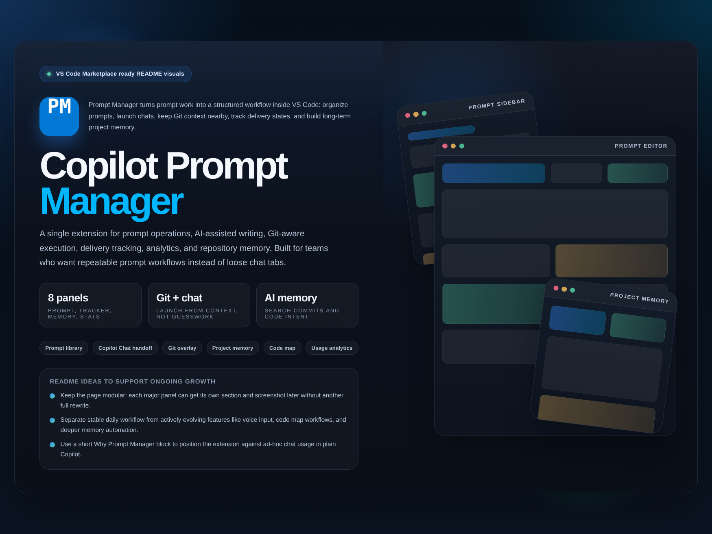
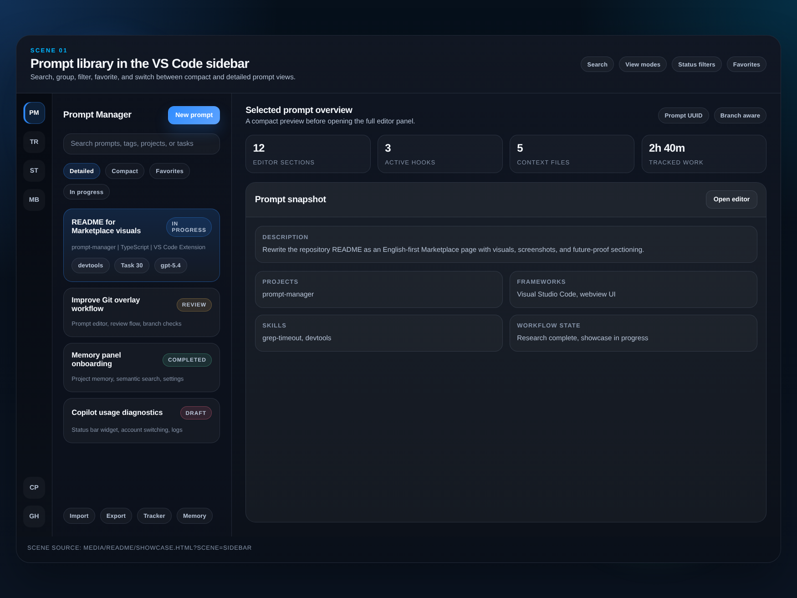
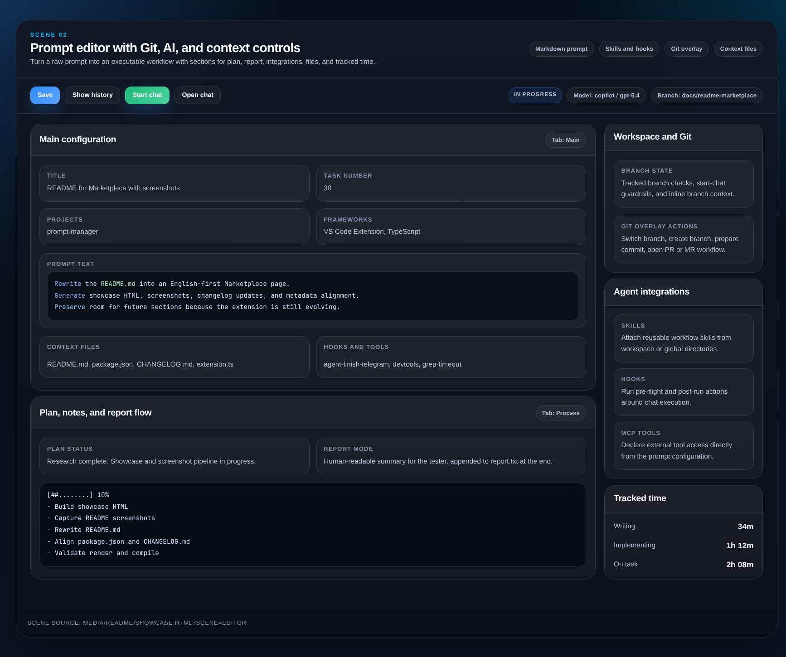
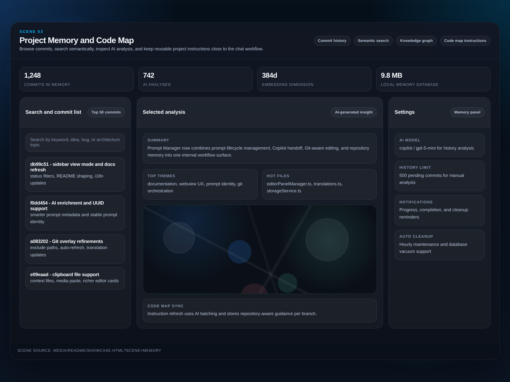

# Prompt Manager

<p align="center">
  
</p>

<p align="center">
  <strong>Prompt workflows that stay attached to your code.</strong><br>
  Run AI chat from saved context, keep Git and delivery state nearby, and build project memory inside VS Code.<br>
  <strong>Промпты, Git-контекст, отчёты и память проекта в одном рабочем процессе прямо в VS Code.</strong>
</p>

<p align="center">
  <a href="https://marketplace.visualstudio.com/items?itemName=alek-fiend.copilot-prompt-manager">Marketplace</a>
  ·
  <a href="https://github.com/atlcomgit/prompt-manager">Repository</a>
  ·
  <a href="https://github.com/atlcomgit/prompt-manager/issues">Issues</a>
</p>

<p align="center">
  
  
</p>

<p align="center">
  
</p>

Prompt work usually gets split across chat tabs, notes, branches, and half-finished checklists.
Prompt Manager turns that mess into one repeatable workflow.

Работа с промптами обычно распадается на вкладки чата, заметки, ветки и разрозненные отчёты.
Prompt Manager собирает это в один понятный и управляемый процесс.

Support: Github Copilot Chat, Codex, Kilo Code, OpenCode CLI, and Claude Code (partial integration).
Поддержка Github Copilot Chat, Codex, Kilo Code, OpenCode CLI и Claude Code (частичная интеграция).

## Why Teams Install It / Зачем это ставят

- **Repo-native prompts.** Prompts, plans, reports, and attached files live in the workspace instead of getting lost in separate tools. Промпты, планы, отчёты и файлы хранятся рядом с репозиторием.
- **AI chat from saved context.** Start or reopen AI Chat from a prepared brief with model, files, instructions, and scope. AI чат запускается из уже подготовленного контекста, а не из памяти пользователя.
- **Git-aware execution.** Keep branches, review flow, task tracking, and delivery status next to the prompt; project branch pickers mark when the prompt branch exists. Git-поток, ветки и статус выполнения остаются рядом с задачей, а списки проектов показывают наличие ветки промпта.
- **Project Memory.** Turn repository history into searchable AI context with analyses, semantic search, and codemap instructions. История репозитория становится рабочей памятью проекта.

## What You Get / Что внутри

| Prompt Library | Prompt Workspace | Project Memory |
| --- | --- | --- |
|  |  |  |
| Organize prompts, search fast, keep favorites and statuses close. | Edit the brief, launch chat, track progress, and stay inside one execution flow. | Reuse repository history, analyses, and semantic search when context matters. |
| Быстрый доступ к промптам, статусам и избранному. | Один экран для подготовки, запуска и сопровождения задачи. | Поиск по истории проекта и повторное использование накопленного контекста. |

## Built For Real Work / Для реальной работы

- **Prompt Sidebar** for library, filters, groups, and fast capture.
  По умолчанию список краткий, сгруппирован по статусу; сортировка «Номер задачи + Дата создания» — по возрастанию.
  Сохранённые настройки вида сохраняются при обновлении расширения.
  В сортировке доступен «Номер задачи»: 2, 10, 170 и ABC-2, ABC-12 сравниваются естественно;
  пустые номера остаются в конце при любом направлении. Комбинированный режим при одинаковых или пустых номерах
  сравнивает дату создания, затем название и идентификатор. Сохранённый ранее выбор сортировки не сбрасывается.
  Task-number sorting supports numeric and prefixed IDs, optionally followed by creation date.
  Hover over a prompt to preview its task number, title, status, and full scrollable Markdown text.
  При наведении на промпт появляется карточка с номером задачи, названием, статусом и полным текстом Markdown.
  Длинный текст прокручивается внутри карточки; Escape закрывает её. С клавиатуры выберите строку через Tab
  и нажмите F2 для перехода к тексту. Просмотр читает сохранённый промпт без открытия редактора и записи файлов.
- **Аккаунты Codex, Claude Code и Copilot.** Страница «Аккаунты» показывает только установленные
  расширения и позволяет вручную выбирать аккаунты. Статус-бар отображает известные ограничения
  Codex и Claude (5ч / 7д); лимиты Claude обновляются раз в 5 минут через официальный CLI `/usage`,
  а все открытые окна VS Code Tunnel используют одну межпроцессную блокировку и общий кэш.
  Лимиты Codex запрашивает только окно в фокусе, остальные окна показывают общий результат.
  Данные `statusLine` и `cachedUsageUtilization` используются как запасные источники; устаревшие значения помечаются.
  Сборщик `statusLine` в настройках Claude Code отключается настройкой `promptManager.claude.statusLineCollector`
  или командой «Удалить сборщик statusLine Claude Code» (собственный statusLine пользователя не меняется).
  Профили Claude изолированы через CLAUDE_CONFIG_DIR; переключение открытых сеансов может потребовать
  повторного подключения или Reload Window. В блоке GitHub Copilot добавлена полоса кредитов
  с использованным процентом, количеством использованных запросов и расчётной датой обновления квоты.
  Статистика берётся из существующего CopilotUsageService; если прямые данные GitHub недоступны,
  показывается отметка о расчётных значениях. Дата сброса дополнена обратным отсчётом (дни и часы),
  который обновляется раз в минуту без сетевых запросов. По умолчанию квоты показывают «Использовано»;
  на странице можно выбрать «Использовано / Осталось». Режим сохраняется глобально во всех окнах
  и проектах VS Code Tunnel, применяется к процентам и прогресс-барам и к статус-барам Codex/Claude.
  Страница прокручивается по вертикали, если блоки не помещаются в высоту вкладки.
  Подробнее: [Аккаунты](docs/rules/Аккаунты/Аккаунты_без_номера.md).
- **Быстрые заметки.** Виджет в панели «Обзор» на странице промпта: короткие заметки, которые потом
  в один клик превращаются в промпт. Щёлкните в поле «Новая заметка…», введите текст и нажмите Enter — заметка
  встанет первой, а курсор останется в поле для следующей; Shift+Enter добавляет строку,
  Ctrl+Enter добавит заметку и сразу откроет её окно.
  Если первая строка новой заметки содержит 100 или больше символов, весь текст автоматически сохраняется
  в описании, а короткое название генерируется через внутренний AI после сохранения.
  Пока название генерируется, в конце поля названия открытого окна заметки показывается лоадер. При отсутствии модели
  остаётся короткое название из начала текста; уже отредактированные вручную названия AI не перезаписывает.
  Переключатель у поля выбирает область: «Проект» (`.vscode/prompt-manager/quick-notes.json`) или «Глобальная»
  (`~/.vscode/prompt-manager/quick-notes.json`); обе области показываются одним списком со значком области.
  В строке заметки — цвет, отметка выполнения, прогресс чек-листа «2/5» (раскрывает пункты для отметки),
  значки описания, файлов и связанного промпта. Порядок меняется перетаскиванием или стрелками на ручке,
  выполненные собираются в блок «Выполнено (N)», есть поиск и фильтр по цвету.
  Кнопка «Открыть» (или двойной щелчок) открывает окно заметки: название, цвет, область, описание, чек-лист
  с кнопкой «Добавить предложение AI» (AI предлагает новый пункт по заметке, текст можно перегенерировать
  или поправить), файлы плитками с последней плиткой «+» (выбор файлов, вставка изображения или путей из буфера,
  перетаскивание из файлового менеджера локального компьютера прямо в блок «Файлы») и «В промпт».
  Через VS Code Remote Tunnel в меню «Добавить» есть отдельные варианты «С этого компьютера…»
  (браузерный выбор файлов на ПК) и «С сервера / проекта…» (файлы Ubuntu).
  Браузерные файлы пересылаются частями по 512 КиБ (до 64 МиБ на файл, до 20 файлов и 256 МиБ за выбор),
  с проверкой полноты и сохранением во временный черновик, без передачи локальных путей в Ubuntu.
  При «Убрать файл» несохранённая копия немедленно удаляется из временной папки сервера;
  сохранённые вложения физически удаляются после «Сохранить», чтобы «Отмена» могла восстановить их.
  Закрытие без сохранения удаляет временные вложения, удаление заметки — её папку файлов.
  Высота поля «Описание» сохраняется глобально для всех заметок и проектов через Settings Sync.
  Правки копятся в черновике и записываются по «Сохранить»
  (Ctrl+S); Escape и «Отмена» спрашивают о несохранённом, Alt+← / Alt+→ переходят к соседней заметке.
  «В промпт» создаёт черновик промпта без открытия редактора: название — из заметки, текст — из описания
  и чек-листа, файлы копируются в `context/` промпта; заметка хранит ссылку на промпт. При удалении
  связанного промпта ссылка сразу снимается с заметки во всех открытых панелях.
  Кнопка доски в заголовке виджета открывает доску стикеров отдельной вкладкой редактора: поиск, фильтр по цвету и области,
  группировка «Сетка / По цвету / По области», добавление прямо на доске (клавиша N; первая строка — название,
  остальные — описание; поле закрывается, когда фокус уходит в другое место, неотправленный текст сохраняется), перенос стикеров мышью и Alt+стрелками. В сетке порядок по строкам,
  при перетаскивании видна карточка у указателя, выделение текста отключено;
  между группами сохраняются смена цвета и области.
- **План на вкладке «Процесс».** В заголовке блока «План» есть переключатель «Краткий / Полный».
  «Полный» показывает весь исходный план. «Краткий» включён по умолчанию у новых промптов
  и оставляет только Markdown-заголовки и пункты чек-листа `[ ]` / `[x]` с их текстом и вложенностью; пояснения и блоки кода скрыты.
  Выбранный режим сохраняется для каждого промпта отдельно и восстанавливается после повторного открытия.
  Выбор хранится отдельно от расположения блоков по UUID и идентификатору промпта, поэтому старые снимки
  расположения его не сбрасывают, а копия папки с тем же UUID не наследует выбор. При переименовании промпта
  обычным сохранением в редакторе выбор переносится на новое имя.
  Старые состояния без сохранённого выбора продолжают использовать «Полный».
  Перед заголовком нового раздела краткий вид оставляет одну пустую строку, если она была в исходном плане.
  Название каждого пункта чек-листа должно быть коротким и понятным само по себе; подробности,
  ограничения и критерии проверки записываются следующими строками с отступом внутри того же пункта.
  Переключение не меняет файл плана, а подсветка обновлённых пунктов сохраняется.
- **Codex inside Copilot** starts with Full Access when launched from Prompt Manager on Linux with a local
  Agent Host supporting AHP 1.1. The new session is named before the task is sent; other chats keep their permissions.
  **Codex внутри Copilot** при запуске из Prompt Manager получает Full Access — доступ к файлам и сети
  без запросов подтверждения. Поддерживается Linux с локальным Agent Host (AHP 1.1).
  Локальное подключение через Unix-сокет совместимо с HTTP-обёрткой VS Code; настройки прокси менять не требуется.
  При неподтверждённых разрешениях отправка отменяется, текст сохраняется в буфере обмена.
- **Copilot Chat autostart** is controlled per prompt in the Agent section. When disabled, the selected
  Copilot mode opens with the prepared prompt in the input without submitting it. Kilo Code keeps its existing
  external-chat autostart behavior. On desktop, OpenAI Codex pastes the prepared prompt through the native VS Code paste command (including Wayland),
  splitting long prompts into parts below its 5,000-character paste-to-file threshold so the text stays editable.
  If focus or clipboard content changes during insertion, preparation stops without submitting a partial prompt.
  In VS Code for the Web (including tunnels), where programmatic paste into the Codex webview is unavailable, the full prompt
  is saved to `task.md` in the prompt folder and attached to a new Codex chat with Codex's own command, so only Send remains.
  Its external-chat autostart flag controls only Xdotool submission on X11. Because Codex exposes no delivery acknowledgement,
  Xdotool submission remains best-effort and does not clear the saved plan. The `Не изменять` option keeps
  the selection already active in the chat. В секции «Агент» автостарт Copilot Chat
  настраивается отдельно для каждого промпта: при выключении выбранный режим открывается с подготовленным
  текстом в поле без отправки. Для Kilo Code сохраняется прежнее поведение, а на desktop OpenAI Codex вставляет текст в
  поле штатной командой VS Code, в том числе в Wayland; флаг автостарта управляет только отправкой через Xdotool в X11. Поскольку Codex не подтверждает
  доставку, такая отправка считается предварительной и не очищает сохраненный план. Опция «Не изменять»
  сохраняет уже выбранный вариант в чате. Длинные запросы вставляются частями меньше порога в 5000 символов,
  чтобы Codex оставлял текст в поле, а не превращал его в файл. При потере фокуса или изменении буфера вставка
  останавливается без отправки неполного запроса.
  Xdotool доступен только в локальном настольном VS Code на Linux; через туннель клавиши на сервер не отправляются.
  В браузере (VS Code Web, в том числе через туннель) штатная команда вставки в webview недоступна, поэтому полный текст
  задачи сохраняется в файл `task.md` в папке промпта и прикрепляется к новому чату Codex его штатной командой:
  для запуска остаётся нажать «Отправить». Файл `task.md` стоит первым в списке файлов чата. Первый запуск после загрузки окна
  длится примерно на 15 секунд дольше: пока панель Codex загружается, прикрепление повторяется, иначе Codex сбрасывает файлы.
  Текст также копируется в буфер обмена, но запуск не ждёт эту запись дольше 2 секунд:
  браузер без фокуса окна может её не завершить. Если прикрепить файл не удалось,
  расширение сообщает о ручной вставке вместо ложного успеха. Само поле сообщения в браузере не заполняется,
  установленный Codex не модифицируется. Ограничения Web-пути и ссылки на документацию описаны
  в [правилах подготовки Codex](docs/rules/Чаты/Подготовка_Codex_без_номера.md).
  Kilo после Add to Context не ожидает дополнительной записи в буфер обмена браузера.
  В Copilot шаг открытия заканчивается после принятия команды; поиск сессии показывается шагом привязки.
- **OpenCode CLI.** Select `Opencode CLI` in the Agent section to open a new interactive terminal and chat.
  Requires OpenCode 2.1.4+ on the Linux extension host, Bash, and terminal shell integration.
  Native file mentions carry the context; automatic sending has its own setting, disabled by default.
  **OpenCode CLI.** Выберите `Opencode CLI` в секции «Агент»: запуск откроет новый терминал и новый чат
  с текстом задачи и файлами. На Linux-хосте расширения нужны `opencode` версии 2.1.4 или новее в ветке 2,
  Bash и включённая настройка `terminal.integrated.shellIntegration.enabled`.
  По умолчанию остаётся редактируемый черновик; отдельный флаг включает однократную автоматическую отправку.
  Модель и разрешения OpenCode не меняются, Plan/Agent передаются в тексте. Xdotool и буфер обмена не нужны,
  в Tunnel терминал запускается на удалённом хосте. «Перейти в чат» возвращает в терминал этого промпта;
  после закрытия терминала запустите новый чат. Останавливайте запрос в самом OpenCode.
  План сохраняется до подтверждения приёма полного запроса с файлами; неподтверждённая отправка не повторяется.
  Установленный Claude Code не перехватывает канал передачи; при ошибке подготовки терминал остаётся открытым
  и сообщение показывает этап, на котором остановился запуск.
  Длинный текст OpenCode может показать меткой `[Pasted ~N lines]`: нажмите на неё, чтобы раскрыть текст в поле.
  Каждый файл и текст промпта начинаются с новой строки. Суффикс `#1` у файла — штатная метка начала с первой строки.
  Поддерживается полная вставка без свёртки; после нового запуска отправка из старого терминала не очищает новый план.
  Название терминала и сессии имеет формат `Номер | Название`, без номера — только название.
  Терминал именуется сразу, сессия — после подтверждённой первой отправки.
  Переименование не задерживает подтверждение отправки; его ошибка не повторяет запрос.
  Подробнее: [правила OpenCode CLI](docs/rules/Чаты/OpenCode_CLI_171.md).
- **Claude Code (partial integration).** Opens prepared text in the installed Claude extension's sidebar for manual sending;
  Agent/Plan are text instructions, not changes to Claude's model or permissions. Session binding uses an exact UUID
  marker after manual sending. Xdotool auto-send is safety-blocked even when enabled because composer focus cannot
  be verified; the notice asks you to send manually. Stop requests inside Claude. End-to-end validation is pending.
  Opening selects `claudeCode.preferredLocation: sidebar` at its existing workspace/global scope;
  existing session tabs are not closed automatically and may be reused by Claude itself.
  **Claude Code (частичная интеграция).** Открывает подготовленный текст в боковой панели Claude для ручной
  отправки; Agent/Plan передаются текстом, модель и разрешения Claude не меняются. Сессия привязывается по точному
  UUID-маркеру после ручной отправки. Автоотправка Xdotool заблокирована даже при включённом флаге: фокус поля ввода
  нельзя подтвердить, поэтому уведомление предлагает отправить текст вручную. Останавливайте запрос внутри Claude.
  Настройка `claudeCode.preferredLocation` переключается на `sidebar` с сохранением её уровня workspace/global;
  уже открытые вкладки не закрываются автоматически и могут переиспользоваться самим Claude.
  Сквозная проверка ещё не проведена.
- **Prompt Editor** for context, files, chat launch, Git-aware execution, plan, and report. Prompt-dashboard cards can be collapsed and reordered from their headers, hidden cards pause their own refresh and AI review work until reopened, the `⋯` menu next to the refresh button lists every widget and hides unchecked ones for all workspaces (hidden widgets load no data until shown again), restored prompt tabs are rebound to the singleton editor after VS Code reload so a stale duplicate webview does not keep a broken save loop, and the prompt-page `AI model` picker mirrors the promoted Copilot Chat picker list instead of flattening the whole catalog, restores visible Custom Endpoint entries from VS Code's cached model catalog when needed, and respects provider-scoped models or whole groups hidden in the VS Code picker, including a model that was already saved on the prompt. When Kilo Code or OpenAI Codex is selected as the target chat, the AI model picker is hidden, Chat Mode stays available, and a per-prompt Xdotool autostart flag is shown. Карточки prompt-dashboard можно сворачивать и переставлять из шапки; скрытые карточки не обновляются и не запускают AI review, пока их снова не раскроют, меню `⋯` рядом с кнопкой обновления показывает все виджеты и скрывает виджеты со снятой отметкой во всех рабочих областях (скрытый виджет не загружает данные, пока его снова не покажут), восстановленная после перезапуска вкладка редактора снова привязывается к singleton-странице и не создаёт вторую нерабочую webview, а поле `Модель ИИ` повторяет promoted-список Copilot Chat picker вместо полного каталога, восстанавливает видимые Custom Endpoint модели из cached catalog при необходимости и не подтягивает provider-scoped модели из скрытых в самом VS Code групп, даже если такая модель уже была сохранена в промпте. Если целевым чатом выбран Kilo Code или OpenAI Codex, поле модели ИИ скрывается, `Режим чата` остаётся доступным, а флаг автостарта через Xdotool показывается для конкретного промпта.
- **Editor layout and Settings Sync.** Reorder sections on Main and Process with the header handle or arrow keys.
  Both orders and all widget preferences are shared; only Main section expansion is global.
  На обеих вкладках разделы можно переставлять за ручку в шапке, стрелками или Home/End; Escape отменяет перенос.
  Последняя активная вкладка сохраняется отдельно для каждого промпта сразу при переключении.
  В vscode.dev через туннель дубли страниц промпта удаляются также после восстановления вкладок VS Code.
  После локальной сборки с синхронизацией расширения выполните `Developer: Reload Window`, чтобы загрузить исправление.
  Кнопки смены статуса находятся в отдельном блоке «Статусы». На вкладке «Процесс» прежняя логика раскрытия
  плана, отчёта и заметок сохраняется; глобально меняется только порядок разделов.
  Настройки интерфейса хранятся в пользовательских настройках VS Code. Для передачи между Desktop,
  Web/Tunnel и устройствами включите Settings Sync с одной учётной записью и синхронизируемым профилем,
  включая категорию Settings. Подтверждение записи означает локальное сохранение; доставка зависит от Sync.
  Старые workspace/localStorage-настройки переносятся первым изменением интерфейса, а существующие
  пользовательские значения имеют приоритет. Привязки раскрытия к конкретным Git/Docker-объектам сохраняются.
- Для перемещения виджета тяните значок точек слева в его шапке к нужному месту.
  В одноколоночном и двухколоночном режимах отдельно запоминаются порядок и сворачивание виджетов.
  Например, сверните «Статус промпта» и переместите «ToDo» вверх в узкой панели, затем расширьте её
  и настройте две колонки по-другому: при возврате к каждой ширине восстановится её собственная расстановка.
  Настройки общие для рабочих областей и сохраняются после повторного открытия редактора.
- **Form and widgets width.** Drag the divider between the prompt form and the widgets, or focus it and use the arrow
  keys (Shift for larger steps) and Home/End; double-click or Enter restores the automatic width.
  Ширину формы и виджетов меняет разделитель между ними: перетаскивание, стрелки (с Shift — крупный шаг), Home/End.
  Двойной щелчок или Enter возвращают автоматическую ширину. Сохраняется доля ширины: она общая для всех промптов
  и обеих вкладок, хранится в `promptManager.editor.panelSplitRatio` и передаётся через Settings Sync.
  Например, расширьте виджеты до двух колонок — после отпускания разделителя они перестроятся один раз,
  а при повторном открытии любого промпта соотношение восстановится. В узком окне (меньше 638 px) виджеты,
  как и раньше, располагаются под формой, а после расширения окна выбранная доля применяется снова.
  В покое разделитель — едва заметная тонкая линия с отступами по 8 px до панелей; при наведении, фокусе
  и перетаскивании она подсвечивается цветом темы.
  При первом переходе на раздельные настройки оба режима используют прежний порядок и сворачивание.
  Если при смене режима раскрывается виджет без загруженных данных, они догружаются автоматически.
  В двухколоночном режиме пустая колонка сохраняет свою сторону и принимает перетаскиваемые карточки.
  Во время движения виджет подсвечивается, а линия показывает место вставки; отпустите кнопку мыши для сохранения.
- Форма сжимается до 300 px, оставляя виджеты справа; при ширине редактора меньше 638 px виджеты
  переходят под форму с общей прокруткой. Например, узкая панель больше не скрывает «ToDo» и Docker.
  Режим, поиск, фильтры и раскрытия виджетов сохраняются глобально вместе с настройками
  обоих вариантов сетки. Переключение промпта не сбрасывает их. При ошибке записи появляется уведомление:
  текущий вид остаётся рабочим, но для сохранения после перезапуска требуется повторить изменение.
- **Reliable automatic title completion** always clears the loading indicator in the current prompt editor after a reload, reopen, or folder rename. Автоматическое создание названия всегда завершает индикатор в актуальном окне промпта после перезагрузки, повторного открытия или переименования папки.
- **Project branches dashboard widget** keeps the last confirmed file line counters visible during lightweight refreshes, refreshes selected and workspace-only rows precisely, and replaces counters after fresh details arrive. Виджет веток проектов не скрывает счетчики строк во время фонового обновления, точечно обновляет выбранные и workspace-only строки и заменяет счетчики после получения свежей детализации.
- Файловые изменения, включая создание и удаление новых файлов, обновляют проекты пакетами с интервалом
  не менее пяти секунд. Служебные пути и исключения `promptManager.codemap.excludedPaths` пропускаются;
  события во время расчёта объединяются в следующее обновление. При возврате в скрытую вкладку прогресс
  задачи перечитывается автоматически.
- **Git Flow — сообщения коммитов.** Генерация использует Kilo Code только при уже активном расширении.
  Если Kilo отсутствует, отключено или ещё не активировано, используется внутренний генератор Prompt Manager без запуска Kilo.
  Для активного Kilo поиск Git-репозитория и выполнение штатной Source Control команды ограничены общими 75 секундами.
  Порядок: активное Kilo → внутренний генератор → штатный Copilot.
  При `promptManager.ai.enabled=false` внутренний генератор пропускается; отсутствие модели, пустой ответ или ошибка LM
  переводят запрос к штатному Copilot. Если вся цепочка не дала сообщения, отображается ошибка вместо шаблонного текста.
  Кнопка «Для всех проектов» запускает выбранные доступные проекты параллельно; внутри каждого сохраняется порядок генераторов.
  Ошибка одного проекта не теряет сообщения остальных, а запросы к одному репозиторию используют общую очередь SCM.
  Сначала проверяется наличие staged-изменений. Для включённого внутреннего генератора собирается компактный контекст:
  небольшие файлы кода, а при их отсутствии — минимальные текстовые изменения; крупные и бинарные данные исключаются.
  Например, при изменении кода вместе с README внутренний генератор получает патчи кода и перечень остальных файлов.
  Имена файлов с подстрокой `test` без учёта регистра исключаются только из собственного контекста, включая перечни:
  `foo.test.ts`, `TestHelper.ts` пропускаются, `tests/helper.ts` остаётся.
  Пустой отфильтрованный набор, ошибки подготовки контекста и чтения файлов инструкций завершают проект ошибкой,
  без перехода к штатному Copilot.
  Штатный Copilot собирает свой контекст самостоятельно; этот фильтр его не ограничивает.
  Перед его вызовом staged-тексты, включая файлы с `test` в имени, загружаются в память VS Code параллельно без вкладок:
  до 32 файлов, по четыре одновременно, не больше 1 МиБ на файл и 4 МиБ суммарно, не дольше пяти секунд.
  Уже открытые документы используются повторно; пропущенные файлы остаются в обычном контексте Copilot.
  Исключение из этой загрузки не уменьшает его запрос, а возвращает файлы к последовательному чтению Copilot.
  Внутренний генератор читает `github.copilot.chat.commitMessageGeneration.instructions` для выбранного проекта:
  поддерживаются `{ "text": "..." }` и `{ "file": "..." }`, передаётся номер текущей задачи.
  Например, правило «Одной строкой, от первого лица, в прошедшем времени» имеет приоритет над стандартным стилем.
  Правило об упоминании тестов также передаётся модели; программной проверки смысла готового ответа нет.
  Каталог поля «Модель ИИ» и внутреннего генератора Git Flow загружается в фоне при активации и используется повторно.
  Смена аккаунта или доступных моделей обновляет кеш и открытые списки. Прогрев не задерживает открытие редактора.
  Если основная модель недоступна, внутренний AI выбирает бесплатного кандидата по точному id из общего кеша;
  при холодном или неполном каталоге сохраняется адресный запрос модели и резервный поиск.
  При включённом `promptManager.debugLogging.enabled` канал Prompt Manager показывает длительность подготовки,
  каждого генератора и доставки результата, а также выбор резервной модели и отмену Copilot по времени.
  События `model-catalog` показывают загрузку общего каталога и выбор из кеша.
  Совпадающее поле Source Control очищается только после подтверждения применения текста в Git Flow;
  новый ручной ввод сохраняется. Успешный внутренний ответ не использует поле Source Control.
  В журнале внутреннему пути соответствуют этапы `internalContext` и `internal`; `copilot` появляется только при резервном вызове.
  После установки новой сборки перезагрузите окно VS Code, чтобы Extension Host загрузил новый код.
- После генерации префикс `🅰️🅻🅴🅺 master | текст` превращается в `🅰️🅻🅴🅺 167 | текст`, если `master`
  входит в tracked-список Git Flow, отличается от ветки промпта, а номер задачи равен `167`.
  Остальной текст сохраняется; при пустом номере, другом префиксе или ручном коммите замена не выполняется.
- **Reusable chat defaults** carry the latest saved target, mode, and related launch fields into regular and Quick Add prompts. Последние сохранённые значения блока настройки чата автоматически выбираются в обычном новом промпте и Quick Add.
- **Docker containers dashboard widget** keeps dense table actions inside vertical-ellipsis menus, aligns transitional actions and aggregate counters with the active filter, leaves raw created containers available to start, and excludes stopped or undeployed service rows from the running filter. Виджет контейнеров согласует действия и общую сводку с активным фильтром, оставляет созданные, но не запущенные контейнеры доступными для запуска и не выводит остановленные или незапущенные сервисы при фильтре «Запущены».
- Compose-файлы ищутся только в корне проекта, включая символические ссылки на файлы.
  Настройка `promptManager.docker.composeFilePatterns` поддерживает `*`, `?`, группы `{yml,yaml}`
  и диапазоны `[0-9]` / `[!0-9]`; например, `compose.{yml,yaml}` находит оба расширения.
- **ToDo dashboard widget** scans selected projects for `todo` and `//?!?`, groups matches as a project/file-type/file/line tree, filters by file type or text, and opens the source file at the matched line. Виджет `ToDo` на странице промпта показывает найденные `todo` и `//?!?` по проектам, типам файлов и строкам, а клик по метке открывает файл сразу на нужной строке.
- **Tracker and Statistics** show actual tracked hours when `Hours` is blank for a selected period, keep all final-table columns in a compact fixed layout with ellipsized titles, separate miscellaneous time, export the currently filtered and sorted table to a real `.xlsx` workbook, include the selected period in HTML/Markdown reports, and refresh active-prompt time after saving. Статистика показывает фактические часы при пустом поле `Часы`, умещает все колонки итоговой таблицы в компактную сетку с сокращением длинных названий, отдельно выводит время «На разное», сохраняет текущую отфильтрованную и отсортированную таблицу в настоящий `.xlsx`, добавляет выбранный период в HTML/Markdown-отчёты и обновляет время активных промптов после сохранения. Положительное время реализации, записанное в `config.json`, защищено от замены устаревшим нулём при сохранении промпта.
- **Project Memory** for commit history, AI analysis, semantic search, and codemap snapshots.
- **AI Usage** for Premium request awareness without leaving VS Code.

## Quick Start / Быстрый старт

1. Install the extension and open Prompt Manager from the Activity Bar. Установите расширение и откройте Prompt Manager на боковой панели.
2. Turn on `Prompt Manager: AI Enabled` only when you want built-in AI generations, reports, or repository analysis. Включайте `Prompt Manager: AI Enabled` только когда нужны встроенные AI-генерации, отчёты и анализ репозитория.
3. Create a prompt, then add the brief, projects, branch, files, and AI model. Создайте промпт и заполните контекст задачи.
4. Save the prompt and launch AI Chat from the editor. Сохраните промпт и запускайте чат прямо из редактора.
5. Enable Project Memory / CodeMap in settings when you want history analysis and chat instructions. Включайте Project Memory / CodeMap в настройках только когда нужны анализ истории и инструкции для чата.
  When these settings stay off, Start Chat does not generate or attach session-memory / codemap instruction files. Если эти настройки выключены, Start Chat не создаёт и не прикладывает session-memory / codemap instruction файлы.

Общая инструкция `share/general.instructions.md` требует задавать необходимые вопросы через интерактивную форму
в любом режиме агента, включая выбор исправлений после ревью. Если синхронная форма ограничена режимом Plan,
агент использует разрешённую асинхронную форму или доступный аналог. При отсутствии всех разрешённых форм
он сообщает техническое ограничение и сохраняет необходимое решение открытым, не подменяя форму текстовым опросом.

## Requirements / Требования

- VS Code `1.95+`
- GitHub Copilot Chat, Codex, Kilo Code for the chat workflow
- Git-enabled workspace folders for branch-aware features
- Optional: enable `Prompt Manager: AI Enabled`, Project Memory, and CodeMap in settings when you want built-in AI automation, repository analysis, and semantic recall

The extension requires a Node.js extension host. Browser-only VS Code without a remote host is not supported.
Для VS Code Web нужен подключённый Node.js Extension Host; в Tunnel OpenCode CLI запускается на Linux-хосте.

## Prompts Stay With The Repo / Где живут промпты

Prompt Manager stores prompt assets inside the workspace, so they travel with the project.
Промпты живут внутри рабочей области и остаются частью проекта.

```text
.vscode/prompt-manager/
├── task-active.json
├── quick-notes.json
├── quick-notes-files/
│   └── <id заметки>/
├── my-prompt/
│   ├── config.json
│   ├── prompt.md
│   ├── plan.md
│   └── report.txt
└── chat-memory/
```

При переключении промпта расширение дожидается сохранения и записывает правки, пришедшие во время записи.
Если сохранение завершилось ошибкой, текущий черновик остаётся открытым. Фоновая генерация названия
использует ту же очередь сохранения и не отменяет сохранённые пользователем текст и номер задачи.

При работе с одной папкой из нескольких окон, в том числе через туннель, список учитывает внешние
переименования и изменения `config.json`. Устаревшие результаты чтения и обновления списка отбрасываются;
если имя папки изменилось до получения файлового события, промпт открывается по стабильному `promptUuid`.
Кнопка обновления в шапке списка заново читает папки промптов и пересоздаёт кеш: исчезают строки
удалённых или переименованных папок, появляются новые промпты и актуальные номера задач.
Если папку хранения прочитать не удалось, ошибка не заменяет прежний список пустым.
Сохранения одного промпта из нескольких окон выполняются по очереди. Если одно окно уже
переименовало папку, попытка записать старый снимок завершается сообщением об изменении каталога.
Откройте актуальную запись перед повторным сохранением. Если на диске уже есть две папки с одним
`promptUuid`, обновление списка сохраняет выделение той папки, которую вы открыли.

Если во время переименования ещё раз изменить текст и сохранить его, в новой папке останется
последняя сохранённая правка. При доступе только для чтения старые промпты можно открывать
из списка и просматривать при наведении, даже если в их конфигурации ещё нет UUID.
В общем хранилище созданные и импортированные папки получают права по тем же правилам, что и
обычные папки этого каталога. При восстановлении истории импортированной копии её привязка
к разговору Claude сохраняется.

При открытии промпта, изменении или начальном восстановлении его выделения в списке расширение обновляет
`task-active.json` в корне хранилища Prompt Manager. Файл содержит `id` (имя папки промпта),
`promptUuid`, `taskNumber` (строка), `title`, `archived` и `promptDirectory` (абсолютный путь к папке).
Путь учитывает архив и переименование. Например:

```json
{
  "id": "123-example",
  "promptUuid": "example-uuid",
  "taskNumber": "123",
  "title": "Пример задачи",
  "archived": false,
  "promptDirectory": "/workspace/project/.vscode/prompt-manager/123-example"
}
```

Для промпта без номера `taskNumber` равен `""`; при снятии выделения или открытии нового,
ещё не сохранённого промпта файл содержит `null`. Быстрое переключение сохраняет последний выбор;
запись выполняется в фоне и заменяет файл целиком, без промежуточного неполного JSON.
Название и номер берутся из сохранённой конфигурации при выборе или открытии, а не при каждом вводе текста.

Быстрые заметки проекта хранятся в `quick-notes.json`, их файлы — копиями в `quick-notes-files/<id заметки>/`.
Глобальные заметки лежат так же в `~/.vscode/prompt-manager/` (при работе через Tunnel — в домашней папке
удалённой машины). Файлы читаемые (JSON с отступами), неизвестные поля сохраняются, запись атомарная;
повреждённый файл не перезаписывается — виджет предлагает открыть его. Изменения из другого окна VS Code
появляются без перезагрузки, а сохранение заметки, изменённой в другом окне, предлагает загрузить актуальную
версию или перезаписать её. Если `.vscode/prompt-manager` хранится в git, копии файлов заметок попадут в репозиторий.

## Разработка через VS Code Tunnel

Локальный VS Code может использовать ссылку на проект. В туннеле каталог расширения остаётся обычной
папкой: это сохраняет зарегистрированный путь для получения API `vscode` из Extension Host.
`npm run compile` после сборки запускает `scripts/sync-tunnel-extension.mjs`. Синхронизация включается
только локальным файлом `.vscode/tunnel-dev.json`, исключённым из Git и VSIX:

```json
{
  "enabled": true,
  "extensionDirectory": "/absolute/path/to/.vscode-server/extensions/prompt-manager-installation",
  "backupDirectory": "/absolute/path/outside/extensions/prompt-manager-backup"
}
```

Скрипт проверяет принадлежность установки, копирует `dist/`, `media/` и манифест, сохраняет зависимости
и метаданные платформы. Исходные файлы резервируются один раз; при ошибке замены выполняется откат.
В реестре обновляются только версия и `metadata.pinned` Prompt Manager, чтобы Marketplace
не заменял локальную сборку автоматически. Отдельная установка через VSIX требуется при изменении
внешних runtime-зависимостей: `node_modules` этот скрипт не обновляет.

Достаточно выполнить `.vscode/bash/compile.sh`, затем **Developer: Reload Window** в окне VS Code
или перезагрузить страницу туннеля. Для отключения синхронизации установите `enabled: false`.
Для отката восстановите `dist/`, `media/`, `package.json` из резервной копии и только запись
Prompt Manager в текущем реестре по `entry.before.json`; остальные расширения сохраняются.

## License

MIT © alek

<p align="center">
  Built for teams who want prompt work to be reviewable, repeatable, and project-aware.<br>
  Для команд, которым нужен не просто чат, а управляемый AI workflow в кодовой базе.
</p>
